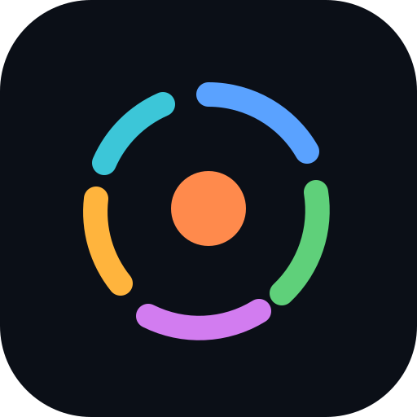
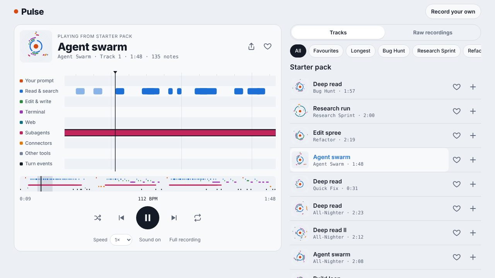

<p align="center"></p>

<h1 align="center">Pulse for Claude Code</h1>

<p align="center"><b>Hear and see Claude Code work.</b><br>
Claude Code sessions become tracks: a piano roll of what Claude did, with a sound for every move.<br>
Every Pulse player opens with a starter pack, so there's something to hear before you record anything.</p>

<p align="center"></p>

## Listen

- **Tracks**: every session is cut into tracks automatically. Pauses are removed and the music runs in its own time, so a 30-second web search is one note, not 30 seconds of silence. Tracks are three minutes at most, at 112 BPM, and every prompt lands on the first beat of a bar.
- **Starter pack**: tracks that play straight away on any Pulse player, including a raw all-night session for the hardcore.
- **Raw recordings**: the whole session in real time, with long pauses shortened while you listen.
- **Share a track**: the share button makes a link with the whole track inside it. Your friend taps it and presses play, no account needed. Only the rhythm travels: no project names, prompts or code.
- **Live mode**: watch and hear Claude work in real time, about a second behind, on any device.
- **The puck**: pop the player out into a small round player that floats on top of your other windows, so you can keep listening while you work. It shows the playing track as a ring of notes, turning in time. Works in Chrome and Edge on a computer.
- **Shuffle, repeat, favourites and playlists**, lock-screen controls on phones, and it installs like an app.

## Record your own, in one click

To turn your own sessions into tracks, you run your own copy of Pulse. Pick the database you like. Each button copies Pulse to your own GitHub and Vercel accounts and sets everything up. Free plans are enough.

| Database | |
|---|---|
| **Neon** (recommended) | [](https://vercel.com/new/clone?repository-url=https%3A%2F%2Fgithub.com%2Fkevinivarson-source%2Fpulse-for-claude-code&project-name=pulse&repository-name=pulse-for-claude-code&env=PULSE_KEY&envDescription=Make%20up%20a%20private%20key%20of%2012%20or%20more%20characters%2C%20no%20spaces.%20It%20locks%20your%20player%20so%20only%20your%20devices%20can%20open%20it.&envLink=https%3A%2F%2Fgithub.com%2Fkevinivarson-source%2Fpulse-for-claude-code%23your-key&stores=%5B%7B%22type%22%3A%22integration%22%2C%22integrationSlug%22%3A%22neon%22%2C%22productSlug%22%3A%22neon%22%2C%22protocol%22%3A%22storage%22%7D%5D) |
| **Supabase** | [](https://vercel.com/new/clone?repository-url=https%3A%2F%2Fgithub.com%2Fkevinivarson-source%2Fpulse-for-claude-code&project-name=pulse&repository-name=pulse-for-claude-code&env=PULSE_KEY&envDescription=Make%20up%20a%20private%20key%20of%2012%20or%20more%20characters%2C%20no%20spaces.%20It%20locks%20your%20player%20so%20only%20your%20devices%20can%20open%20it.&envLink=https%3A%2F%2Fgithub.com%2Fkevinivarson-source%2Fpulse-for-claude-code%23your-key&stores=%5B%7B%22type%22%3A%22integration%22%2C%22integrationSlug%22%3A%22supabase%22%2C%22productSlug%22%3A%22supabase%22%2C%22protocol%22%3A%22storage%22%7D%5D) |
| **Any other Postgres** | [](https://vercel.com/new/clone?repository-url=https%3A%2F%2Fgithub.com%2Fkevinivarson-source%2Fpulse-for-claude-code&project-name=pulse&repository-name=pulse-for-claude-code&env=DATABASE_URL,PULSE_KEY&envDescription=Make%20up%20a%20private%20key%20of%2012%20or%20more%20characters%2C%20no%20spaces.%20It%20locks%20your%20player%20so%20only%20your%20devices%20can%20open%20it.&envLink=https%3A%2F%2Fgithub.com%2Fkevinivarson-source%2Fpulse-for-claude-code%23your-key) |

When Neon asks, pick the Free plan and you can switch **Auth** off. Pulse locks itself with your key and doesn't use Neon's login feature.

During setup Vercel asks for one thing:

<a id="your-key"></a>
**PULSE_KEY**: make up a private key of 12 or more characters, like a password, without spaces. It locks your player so only your devices can open it.

Prefer not to keep the key itself in Vercel? Set `PULSE_KEY_SHA256` to its SHA-256 fingerprint (64 hex characters) instead, for example from `printf '%s' 'your-key' | sha256sum`. Your devices still pair with the key itself.

## Start recording

1. Open `https://<your-pulse>.vercel.app/#pair=<your PULSE_KEY>` on your computer. That device is now paired.
2. In Pulse, open **Pair device** and click **Copy Claude Code setup**. Paste it into Claude Code and say yes. It saves your player's address and key and switches the Pulse plugin on in your Claude Code settings. No plugin commands to type.
3. Restart Claude Code. Pulse installs itself as it starts.
4. Start working. Your session appears live in the player.
5. On your phone, open **Pair device** on the computer and scan the code, then add Pulse to your home screen.

**Windows:** the plugin's hooks run in Bash, so install [Git for Windows](https://git-scm.com/downloads/win) (Claude Code recommends it on Windows anyway).

## Private by design

Your sessions live in your own database. Pulse records only event types, tool names and the project folder name, never your prompts, code or files. Share links carry even less: the rhythm and the lane of each tool, nothing else.

## What you hear

| Lane | Sound |
|---|---|
| Your prompt | Kick drum |
| Read and search, edit and write, terminal, web, subagents, connectors | A note each, on a pentatonic scale, so it always sounds musical |
| Each tool finishing | A soft tick |
| Claude finishes a turn | A chord |
| Claude is waiting for you | A bell |
| Context compaction | A swell |

## How it works

```
Claude Code ──(plugin: one tiny line per event)──► your Vercel app ──► your Postgres
                                                        ▲
                       phone / tablet / computer ───────┘  (live, about once a second)
```

- **plugin/** is a Claude Code plugin made of hooks: one short Bash script, [`plugin/pulse.sh`](plugin/pulse.sh), worth a read before you install. It writes a local backup in `~/.claude/pulse` and sends events in the background. It never slows Claude down, and catches up if you were offline.
- **api/** has four small endpoints: ingest, sessions, events and library. Tables are created automatically on first run.
- **index.html** is the player: one page, no framework, no build step.
- **tracks.js** cuts recordings into tracks and packs a track into a share link. It has no dependencies, so you can use it in your own tools.
- **starter/** is the starter pack: recordings in the `.pulse` format (see below).

## The .pulse format

One recording per file, the same plain text the plugin keeps in `~/.claude/pulse`. The first line is `<date> <project>`, then one line per event: `<epoch-ms> <code> [tool]`.

| Code | Event | Code | Event |
|---|---|---|---|
| `S` | Session starts | `A` | A subagent finishes |
| `U` | You send a prompt | `E` | Claude finishes a turn |
| `T` | A tool starts (tool name follows) | `N` | Claude is waiting for you |
| `D` | A tool finishes (tool name follows) | `C` | Context compaction |
| | | `Q` | Session ends |

## How tracks are cut

The Auto rules: a quiet spell of 15 minutes or more ends a stretch of work, and tracks never cross one. Within a stretch, cuts go where they sound natural: between prompts first, then between tool calls, never just before a turn's closing chord. Tracks are 30 seconds to 3 minutes. A stretch too thin for a track is a sketch: it stays in the raw recording but isn't listed as a track. Cuts are worked out on your device and never stored as copies, so better rules can recut old recordings at any time.

## Build on it

Be my guest. Fork it, change it, make it yours. Ideas and improvements are welcome as issues or pull requests.

Run it locally with `npx vercel dev` and a `DATABASE_URL` pointing at any Postgres. `node tools/test-tracks.mjs` checks the track cutter. New starter tracks are welcome: see [starter/README.md](starter/README.md).

## License

MIT. Use it freely; it comes with no warranty. Made by Kevin Ivarson with Claude.

<sub>Pulse is an independent project and is not affiliated with or endorsed by Anthropic.</sub>
